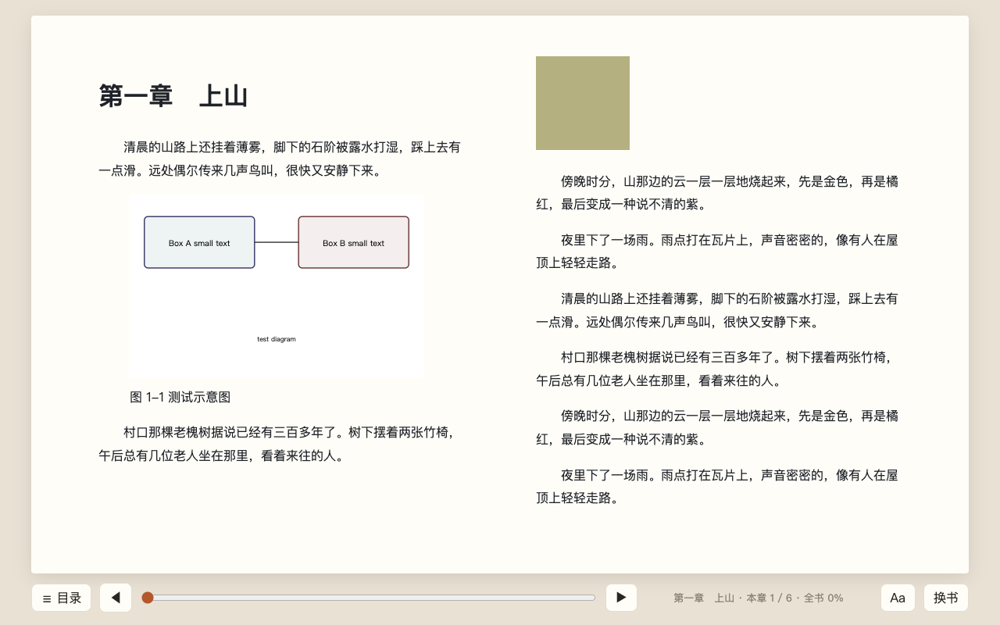

# Emily阅读

一个在自己电脑上运行的 EPUB 电子书阅读器。两页并排，像翻一本真书。



## 为什么做它

我平时读中文书，也读一些英文书，常用微信读书。我想要一个更顺手、只做好「读书」这一件事的阅读器，所以做了它。现在我每天用它读书。

书和阅读进度都只存在自己电脑的浏览器里，不需要注册账号，也不联网。

## 能做什么

| 功能 | 说明 |
|---|---|
| 打开 EPUB | 选一个 `.epub` 文件就能读，中文、英文都可以 |
| 两页排版 | 窗口够宽时左右两页并排，窗口窄时自动变成单页 |
| 翻页 | 用底部的 ◀ ▶ 按钮，或键盘的 ← →、PageUp / PageDown |
| 目录 | 按章列出，可以展开小节，读到哪一节就高亮哪一节 |
| 全书进度 | 显示读了百分之几，拖动进度条可以跳到任意位置 |
| 脚注 | 点注释编号跳过去看，点「返回」回到原来那一页 |
| 记住位置 | 关掉网页再打开，自动回到上次那本书、那一页 |
| 阅读设置 | 字号 80%～160%，可选黑体或宋体，可选浅色或深色 |
| 图片放大 | 点书里的图片，可以放大看清楚 |
| 中文排版 | 中文书的段落首行缩进两个字，行距更宽 |

## 怎么运行

需要先在电脑上装好 [Node.js](https://nodejs.org/)。

```bash
npm install     # 第一次运行前安装依赖
npm run dev     # 启动阅读器
```

然后在浏览器里打开 http://localhost:8766 。

macOS 上也可以用 `scripts/launch.sh` 启动。它会在后台启动阅读器（已经在运行就不会重复启动），然后自动打开浏览器，适合做成双击就能打开的图标。

## 测试

```bash
npm test           # 单元测试
npm run test:e2e   # 浏览器测试：在真实的 Chrome 里模拟打开书、翻页、跳转等操作
```

## 怎么做出来的

- 用到的技术：[epub.js](https://github.com/futurepress/epub.js)（显示电子书）、[Vite](https://vite.dev/)（本地运行）、[Vitest](https://vitest.dev/) 和 [Playwright](https://playwright.dev/)（测试）。
- 我不写代码。这个项目是我和 AI 编程助手 [Claude Code](https://claude.com/claude-code) 一起完成的：我提需求、定方向、做验收，代码由 Claude Code 编写。
- 开发流程是：先写产品设计（[docs/product-design.md](docs/product-design.md)），再写技术方案（[docs/tech-design.md](docs/tech-design.md)），然后一条一条地做功能。每条功能都有验收标准和自动测试，每次改动都单独记录，方便回退。

## 下一步

- 第一版的验收标准是：我用它完整读完一本中文书，把读的过程中不顺手的地方记下来，作为下一轮的修改清单。
- 第二版计划加入「划词」：选中一个词，就能查释义或翻译。
